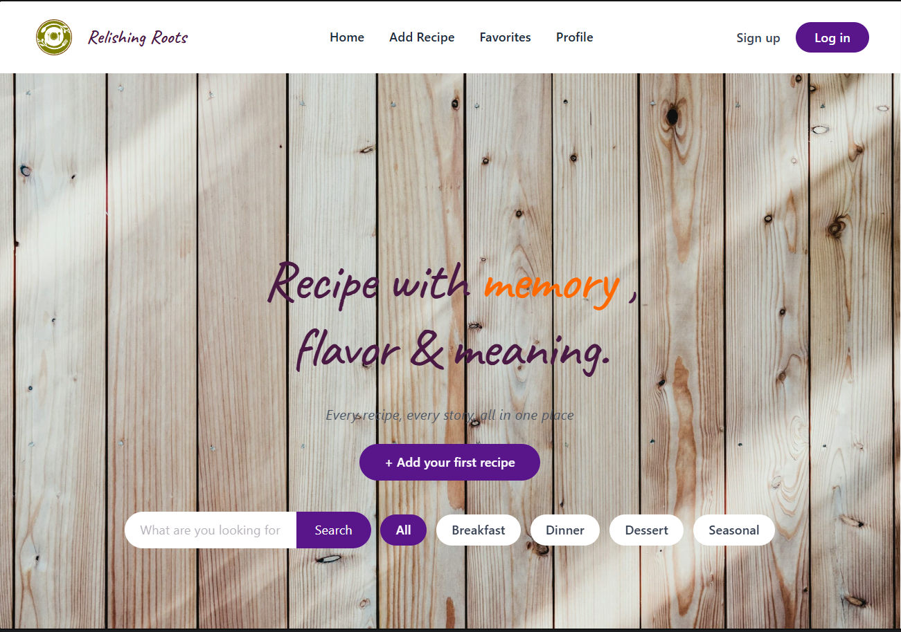
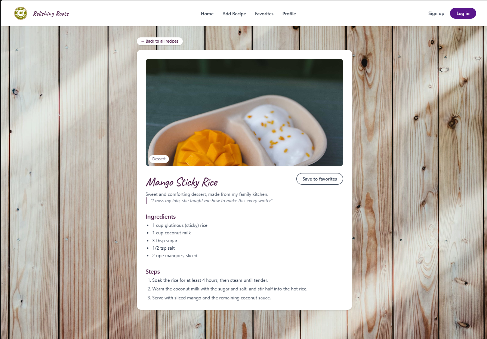
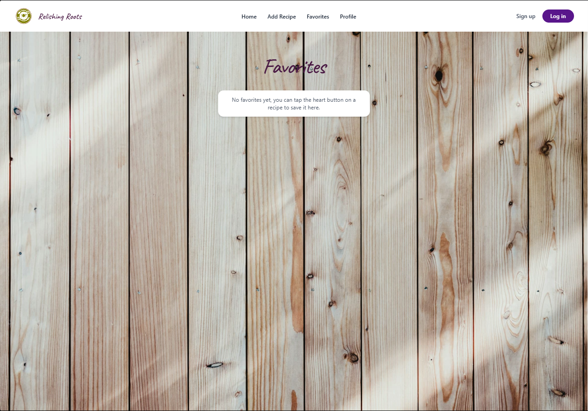
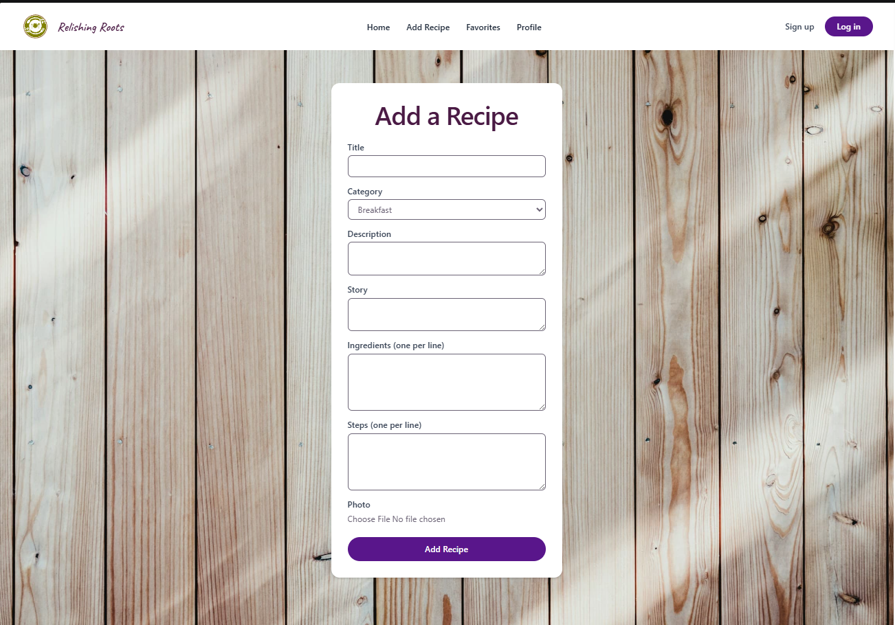
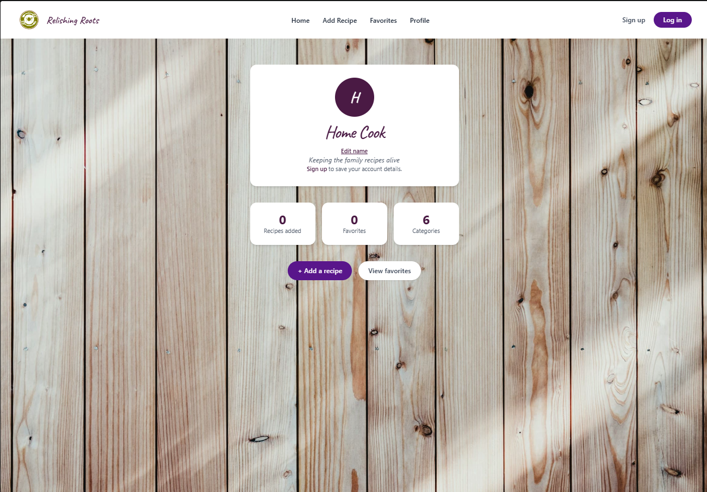
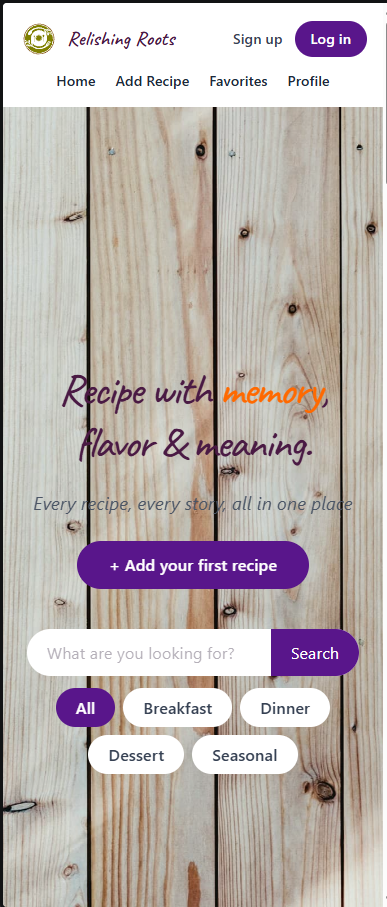

# Relishing Roots

A recipe site for family dishes and stories. Easily browse and search recipes with filters, view full recipe pages with the story, ingredients and steps, save your favorites and add your own recipes.

This is a frontend-only project. (see [Limitations](#limitations)).

## Screenshots

| Home | Recipe page |
| --- | --- |
|  |  |

| Favorites | Add a recipe |
| --- | --- |
|  |  |

| Profile | Mobile view |
| --- | --- |
|  |  |

## Features

- Browse a grid of recipe cards with a story and photo for each one
- Filter by category (Breakfast, Dinner, Dessert, Seasonal) and search by title or category
- Recipe pages with a large photo, the story, ingredients and steps
- Favorites: tap the heart on any card or recipe page, then see them all on the Favorites page
- Add a recipe with a title, category, description, story, ingredients, steps and an optional photo
- Profile page with live counts (recipes added, favorites, categories)
- Sign up / Log in screens (simulated, see below)
- Responsive layout and fade-in-on-scroll animations

## Tech

React 19, Vite, Tailwind CSS v4, React Router.

## Getting started

Make sure you have the latest Node.js LTS version.

Install the dependencies
```bash
npm install
```

Start the development server
```bash
npm run dev
```
Then open the address printed by Vite (it will be something like http://localhost:5173).
| Command | Info |
| --- | --- |
| `npm run dev` | Starts the development server |
| `npm run build` | Builds the production version in the `dist` folder |
| `npm run preview` | Runs a local preview of the production build |
| `npm run lint` | Runs ESLint to check for syntax errors |

## Project structure

```
src/
├── main.jsx               App entry point (mounts React, wraps in the router)
├── App.jsx                Shared state (recipes, favorites, user) and all routes
├── index.css              Tailwind import and global styles
├── data/
│   └── recipes.js         The starter recipes (edit these!)
├── pages/                 One file per screen/route
│   ├── Home.jsx           Hero, search, filters and the recipe grid   (/)
│   ├── RecipeDetail.jsx   A single recipe                             (/recipe/:id)
│   ├── AddRecipe.jsx      Form to add a recipe                        (/add-recipe)
│   ├── Favorites.jsx      Favorited recipes                           (/favorites)
│   ├── Profile.jsx        Profile and stats                           (/profile)
│   ├── SignUp.jsx         Sign up form                                (/signup)
│   └── Login.jsx          Log in form                                 (/login)
├── components/            Reusable pieces used across pages
│   ├── NavBar.jsx
│   ├── Hero.jsx
│   ├── RecipeCard.jsx
│   └── RevealOnScroll.jsx Fade-in animation wrapper
└── assets/                Images imported by the code (hero background, logo)
public/
└── ImagesForRecipe/       Photos for the starter recipes
```

`pages/` holds components that are a whole screen tied to a URL. `components/` holds smaller pieces reused inside pages.

## How the data flows

The App.jsx file holds the shared state (recipes, favorites, user) and feeds it to the pages as props, along with functions that 
can modify it (add a recipe, toggle a favorite, log in or out). The Home and Favorites both read from the same recipes and 
favorites, which is why hearting a card on one page will reflect on the other.

## Editing the starter recipes

Open the file src/data/recipes.js. Each recipe holds an image, category, title, description and story. 
The ingredients and steps for each starter recipe are in the details object near the bottom of that file, keyed by recipe title. 
Those are sample versions, so you should replace them with your family's real ones.

To add a photo to a starter recipe, copy the image into public/ImagesForRecipe/ , then reference it as 
/ImagesForRecipe/YourFile.jpg (start the path with a `/`, so the photo also shows on recipe pages). 
We recommend keeping photos at around 900px wide and under about 150 KB in size -- larger images can cause lag when scrolling.

## Limitations

None of the data is stored. Your favorite recipes, recipes that you added, and your log in info will all be erased once you refresh the page. Also, any recipe you add will show "Recipe not found" if you refresh the page while viewing the recipe.
Photos you upload are only stored in the browser for the session they are uploaded in.
Sign up and Log in is all fake. It will take any email and password you put in and will not save it. The email you see when you log in is whatever email you signed up with, but you can type in any email and it'll still work. There is no real log in system or accounts.
Favorites are synced by title. It'll see any two recipes with the same title as the same recipe. It will have the same favorited status and everything. So just be careful not to have two recipes with the same title.

## Next step

- A backend and database for recipes, favorites and accounts to persist (or `localStorage` as a simpler first step)
- Real authentication
- Edit and delete for recipes you've added
- Filter pills for "Comfort" and "Holiday" categories (recipes only show up under "All" now)